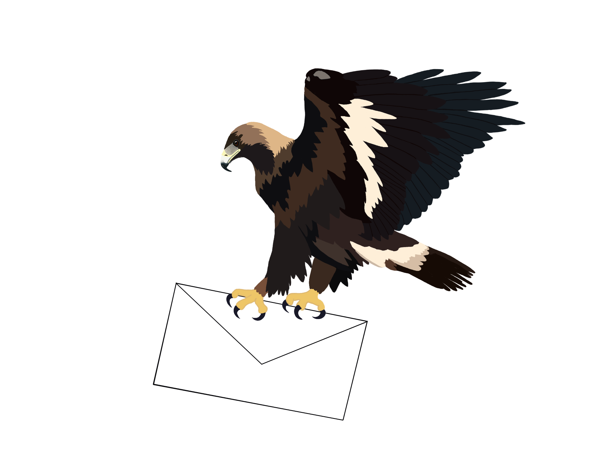

If you have any questions about my research, here's how to find me.

<i class="fas fa-envelope" aria-hidden="true"></i> [ashleysantiago@u.boisestate.edu](mailto:ashleysantiago@u.boisestate.edu)  
<i class="fas fa-university" aria-hidden="true"></i> Boise State University · Boise, ID

## Links

[<i class="fab fa-github" aria-hidden="true"></i> GitHub](https://github.com/AshSantiago){: .btn .btn--inverse}
[<i class="fab fa-researchgate" aria-hidden="true"></i> ResearchGate](https://www.researchgate.net/profile/Ashley-Santiago){: .btn .btn--inverse}
[<i class="fab fa-orcid" aria-hidden="true"></i> ORCID](https://orcid.org/0009-0008-8372-4077){: .btn .btn--inverse}

{: .align-center style="max-width: 420px; width: 100%;"}
