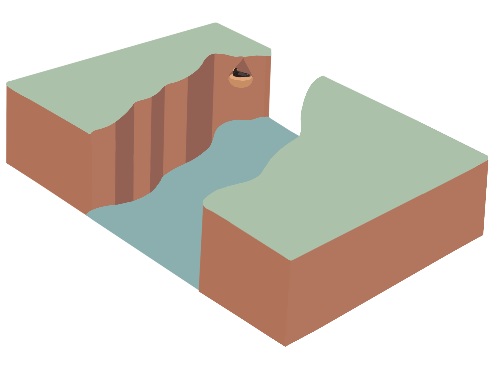
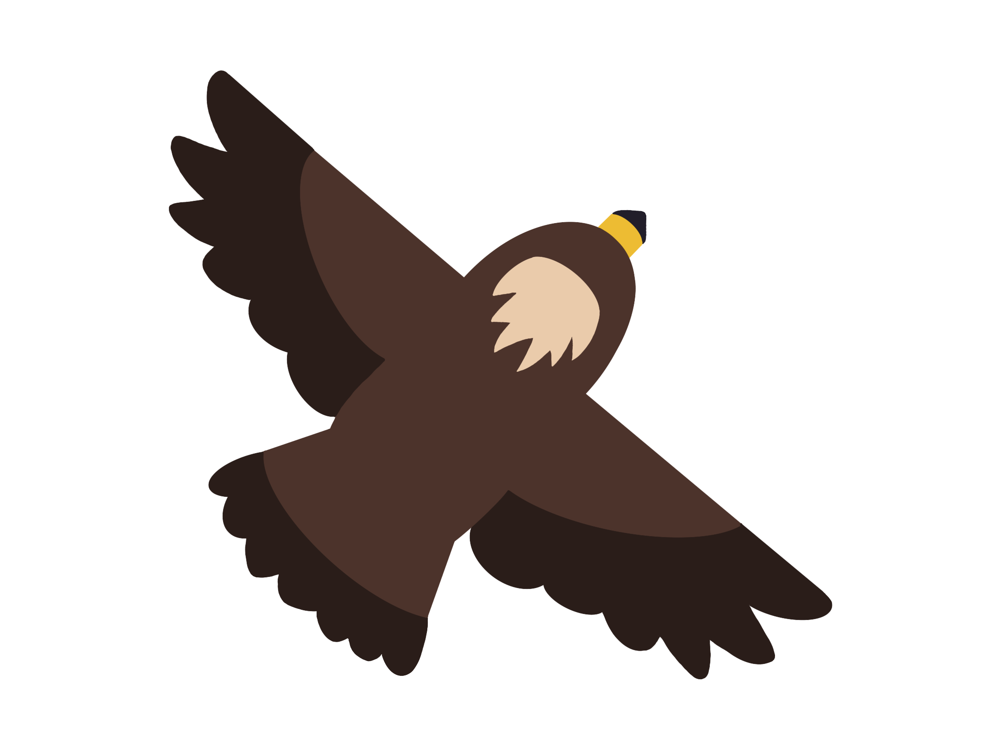
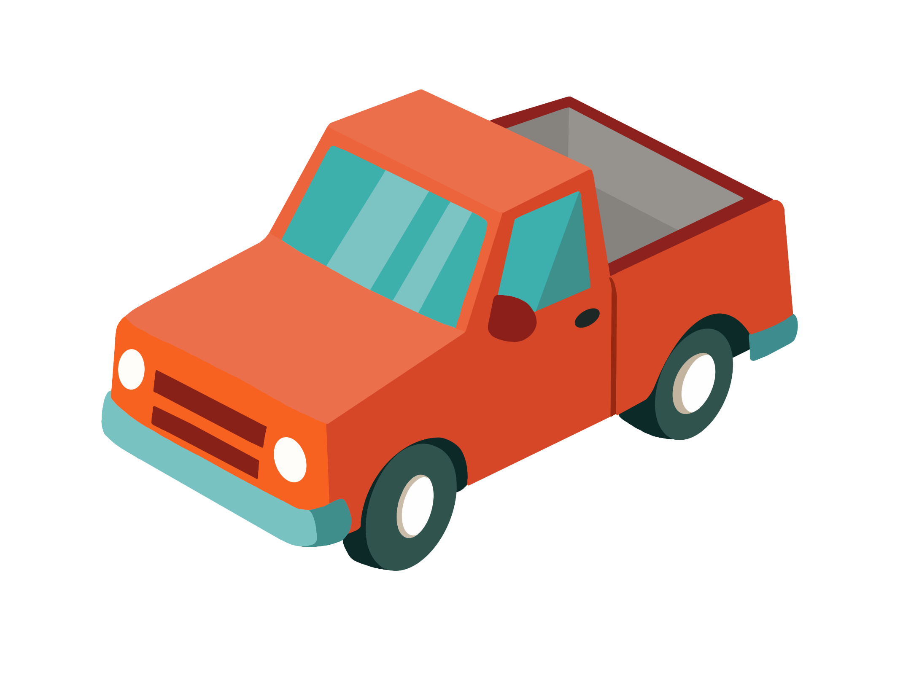
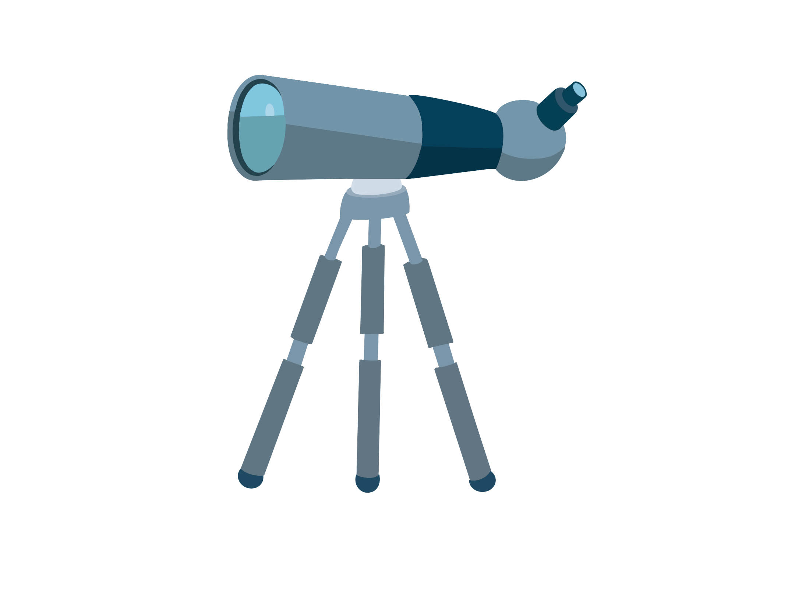







<!-- Interactive field-site map (your custom piece; kept as HTML) -->

  
Explore

  <h2 style="margin: 0;">Click around the field site</h2>

  

  <a class="nav-icon" href="/research" style="top: 23.5%; left: 24%; width: 24.5%;">
    
Research

    
  </a>

  <a class="nav-icon" href="/publications" style="top: 37.5%; left: 46.5%; width: 28%;">
    
Publications

    
  </a>

  <a class="nav-icon" href="/about" style="top: 28%; left: 65%; width: 14%;">
    
About

    
  </a>

  <a class="nav-icon" href="/contact" style="top: 23.5%; left: 59%; width: 12%;">
    
Contact

    
  </a>

  <a class="nav-icon" href="/cv" style="top: 34%; left: 74%; width: 9%;">
    
CV

    
  </a>

