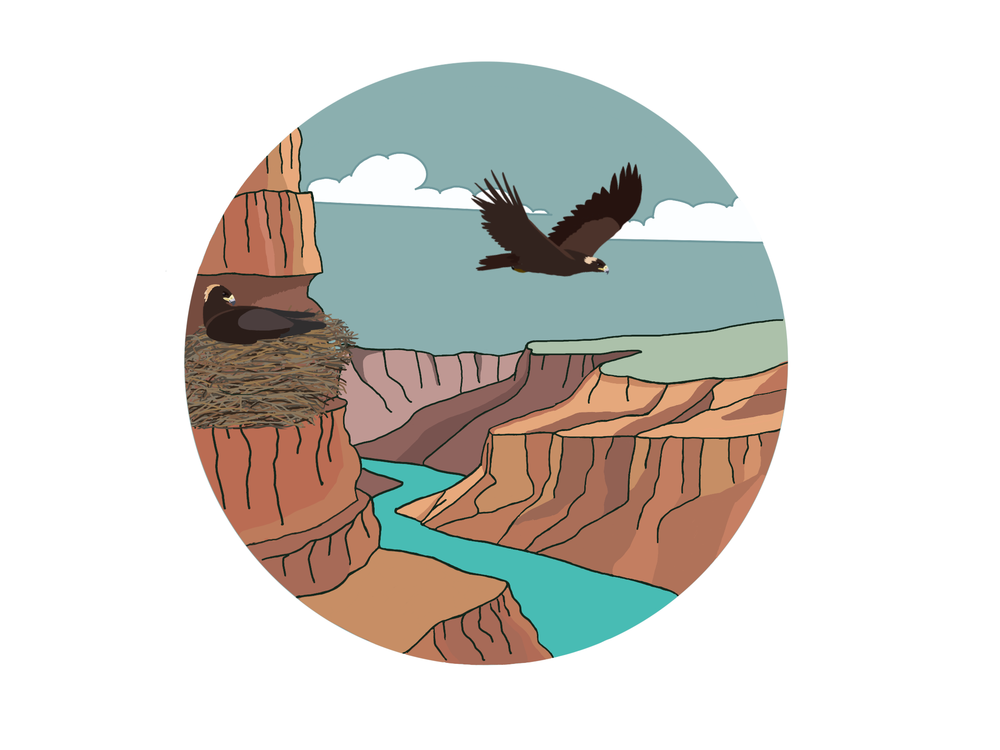
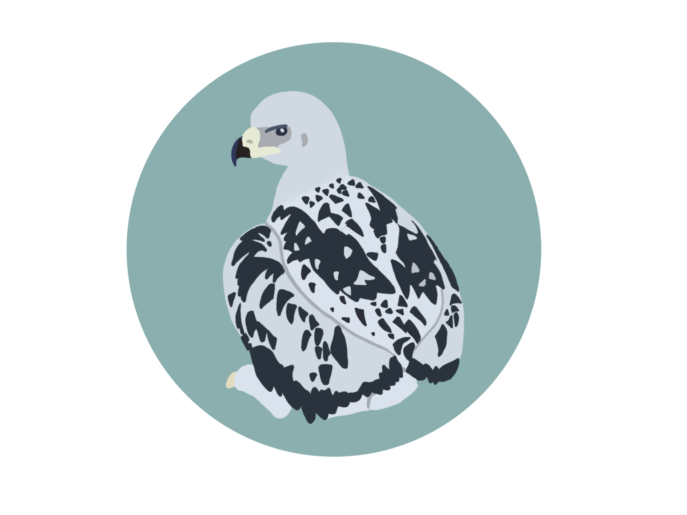
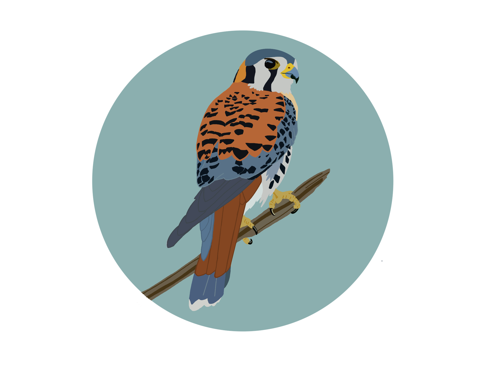

ORCID: [0009-0008-8372-4077](https://orcid.org/0009-0008-8372-4077)

## 2025

**Santiago, A.L.**, Cruz, J., Delparte, D.M., Kochert, M.N., Steenhof, K., Weldon, J.M., Heath, J.A. (2025). Landscape Changes and Declines in Golden Eagle (*Aquila chrysaetos*) Territory Occupancy in Southwestern Idaho. *Ornithological Applications* 128(1), 1–10. [https://doi.org/10.1093/ornithapp/duaf054](https://doi.org/10.1093/ornithapp/duaf054)

Heath, J.A., Davis, C.M., Dudek, B.M., McClure, C.J.W., Myers, K.T., Regnier, E.K., Rolek, B.W., **Santiago, A.L.** (2025). Ectoparasite and trichomonosis management improve nestling golden eagle (*Aquila chrysaetos*) health and survival: An effective mitigation strategy. *Journal of Applied Ecology* 62(10), 2764–2773. [https://doi.org/10.1111/1365-2664.70149](https://doi.org/10.1111/1365-2664.70149)

## 2024

**Santiago, A.**, & Van Buskirk, R. (2024). Book Review: The Kestrel: Ecology, Behaviour and Conservation of an Open-Land Predator. *Journal of Raptor Research* 58(4), 547–549. [https://doi.org/10.3356/jrr24505](https://doi.org/10.3356/jrr24505)

